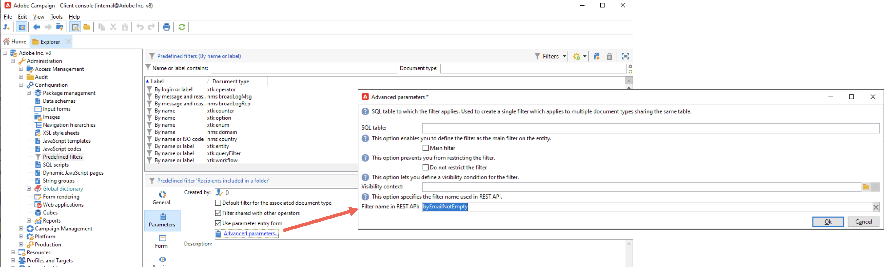

# Differences between Campaign Standard and Campaign v8 {#acs-v8-differences}

Most concepts are the same in Campaign Standard and Campaign v8. This page gathers the differences that affect you after the transition, and links to the page that explains each one. It complements the guides for [marketers](marketers.md) and for [administrators and developers](admin-developers.md).

* For the terminology changes, see [Key differences between Campaign Standard and Campaign v8](overview.md#experiences).
* For the checks to run and the issues reported after a transition, see [Checks and troubleshooting after the transition](post-transition-checks.md).
* For the capabilities that are available only in the client console, see [Campaign Web and Campaign client console](../../v8/get-started/capability-matrix.md).

## Channels and content {#channels}

The steps to create and send messages are similar in both products, as described in the [guide for marketers](marketers.md). The differences below concern channel availability, test deliveries, landing pages and direct mail workflows.

| What changes | Learn more |
|---|---|
| The In-App channel is not available in Campaign v8. | [In-App channel](marketers.md#acs-gs-marketers-in-app) |
| To transition existing push workflows and deliveries, contact your Adobe Campaign Transition Manager. | [Push notifications](marketers.md#acs-gs-marketers-push) |
| In Campaign Standard, a test profile could be marked as a **Trap** to receive the final send. In Campaign v8, add a **Trap group** in the Audience settings of the delivery. | [Trap group](../../v8/audience/trap-group.md) |
| Landing pages created in the Campaign Web user interface do not support hidden input fields or custom JavaScript. | [Landing pages](../../v8/landing-pages/get-started-lp.md) |
| In Campaign Standard, the outbound transition of a direct mail activity also carried the generated file. In Campaign v8, it carries only the targeted population. To send the file to a server, add a **Data extraction** activity, then a **File transfer** activity. | [Direct mail](https://experienceleague.adobe.com/en/docs/campaign/campaign-v8/send/direct-mail){target="_blank"} |

## Audiences, workflows and deliveries {#data-and-workflows}

These differences affect the audiences and workflows migrated from Campaign Standard, some options of recurring deliveries and of the **File transfer** activity, and the scope of dynamic reporting.

| What changes | Learn more |
|---|---|
| Audiences created with the Query activity in Campaign Standard become [predefined filters](../../v8/query/build-query.md) in Campaign v8. Campaign v8 also supports the Query activity. | [Manage audiences](marketers.md#acs-gs-marketers-audiences) |
| A Read audience activity becomes a Query activity with a predefined filter. | [Manage audiences](marketers.md#acs-gs-marketers-audiences) |
| A predefined filter takes only the latest value after the audience is migrated. | [Manage audiences](marketers.md#acs-gs-marketers-audiences) |
| File-type audiences become List-type audiences without dimensions. | [Manage audiences](marketers.md#acs-gs-marketers-audiences) |
| Historical logs of workflows executed in Campaign Standard are not migrated. | [Create a workflow](marketers.md#acs-gs-marketers-wf) |
| In Campaign Standard, you could select the aggregation period of a recurring email. This option is not available in Campaign v8. | [Channel activities](../../v8/workflows/activities/channels.md) |
| Dynamic reporting covers email deliveries, campaigns with email deliveries, and transactional messages. | [Reporting](marketers.md#acs-gs-marketers-reporting) |

## Access and security {#access}

Campaign Standard security groups, roles and organizational units are mapped to operator groups, named rights and folder permissions during the transition. Review the points below, in particular if some users have broader or narrower rights than before.

| What changes | Learn more |
|---|---|
| Security groups, roles and organizational units are mapped to operator groups, named rights and folder permissions. Custom roles are not migrated. | [User access management](user-management-acs.md) |
| Users with the **Data Model** role but not the **Administration** role gain **Administration** access. | [User access management](user-management-acs.md#migration-approach-from-user-roles-to-named-rights) |
| Users assigned to security groups with parallel organizational units can have broader access in Campaign v8. | [Parallel organizational unit assignment](user-management-acs.md#parallel-assignments) |
| Accessing transactional APIs from the execution instance requires a new product profile. | [Product profile mapping](user-management-acs.md#product-profile-mapping-to-access-rest-apis) |
| Privacy requests can arrive in both Campaign Standard and Campaign v8 during the period when your Campaign Standard environment remains active. | [Privacy and consent](admin-developers.md#privacy-and-consent) |

## APIs and integrations {#apis-and-integrations}

These differences affect the integrations that call Campaign through its REST API, and the integrations with other Adobe solutions and tools.

| What changes | Learn more |
|---|---|
| PKEY values change after the migration. If you store PKEYs outside Campaign, follow the hrefs returned by the API instead. | [Key usage](#key-usage) |
| Some migrated profile fields, such as time zone and `ccpaOptOut`, are returned only by the `profileAndServicesExt/profile` API. | [Profile time zone](#profile-timezone) |
| Adobe migrates your Adobe Analytics and Audience Manager configurations. You must set up the Triggers and Adobe Target integrations again. | [Manage Adobe Campaign integrations](admin-developers.md#acs-gs-integrations) |

## REST API recommendations and limitations {#rest-api-limitations}

The recommendations and limitations below apply to the REST APIs when you transition from Campaign Standard to Campaign v8.

### Permissions and security {#permissions}

#### Product profiles mapping {#rest-product-profiles}

In Campaign Standard, you were granted elevated admin role access to APIs regardless of your assigned product profile. Campaign v8 introduces a different set of product profiles, requiring mapping from Campaign Standard to Campaign v8 product profiles.

With the migration, two product profiles are added to your existing or pre-created technical accounts: Administrator and Message center (for accessing transactional APIs). Review the product profile mapping and assign the needed product profile if you do not want the Admin product profile mapped with your technical account.

#### Tenant ID

After migration, for any future integrations, it is recommended to use your **Campaign v8 tenant ID** in REST URLs, replacing your previous Campaign Standard tenant ID.

#### Key usage

Management of PKey values differs between Campaign Standard and Campaign v8. If you were storing PKeys with Campaign Standard, ensure your implementation dynamically forms subsequent API calls using PKeys or hrefs obtained from previous API calls.

### Available APIs {#available-apis}

For now, the REST APIs listed below are available for use:

* **Profiles**
* **Services & subscriptions**
* **Custom resources**
* **Workflows**
* **Transactional messages**

>[!AVAILABILITY]
>
>For now, the **Transactional messages** REST API is not available.
>
>The REST APIs listed below are deprecated and not available for use:
>* Marketing history
>* Organizational units
>* Privacy management

### Filtering {#rest-filtering}

* To use your filters in REST API payloads, you need to edit them in Campaign v8 and provide a name to use in your payloads. To do so access the filter's additional parameters from the **[!UICONTROL Parameters]** tab, and provide the desired name in the **[!UICONTROL Filter name in REST API]** field.

    


* The "by" prefix required to use custom filters is no longer needed. The filter name should be used as-is in your requests.

    Example:
    
    `GET https://mc.adobe.io/<ORGANIZATION>/campaign/profileAndServicesExt/<resourceName>/<customFilterName>?<customFilterparam>=<customFilterValue>`

### Dropped database fields {#dropped-fields}

Some fields from the database are being dropped during migration. When using a dropped field, REST APIs will return blank values. In the future, all dropped fields will be deprecated and removed.

### POST with linked resources {#post-linked}

When using the following request body format, with "vehicleOwner" representing the link to "nms:recipient":

```
{
    "vehicleNumber": "20009",
    "vehicleName": "Model E",
    "vehicleOwner":{
        "firstName":"tester 11",
        "lastName":"Smith 11"
    }
}
```

The link information is ignored. Consequently, a new record is generated under "cusVehicle" containing only "vehicleNumber" and "vehicleName" values. However, the link remains null, resulting in "vehicleOwner" being set to null.

In Campaign v8, when the same request body structure is used and the "vehicle" is linked to a profile, an error occurs. This error occurs because the "firstName" property is not recognized as valid for "cusVehicle.". However, a request body comprising only the attributes without the link functions without any issues.

### PATCH operations {#patch}

* Campaign v8 does not support PATCH with an empty request body: it returns a 204 No Content status.
* While Campaign Standard supports PATCH on elements/attributes within a schema, note that PATCH operations on location are not supported in Campaign v8. Attempting a PATCH on location will result in a 500 Internal Server Error with an error message indicating that the 'zipCode' property is not valid for the 'profile' resource.

### REST responses {#rest-responses}

The section below lists minor differences between Campaign Standard and v8 REST responses.

* For single GET records, the response includes the href in the response.
* When queried with the attribute, Campaign v8 provides Count and Pagination in the response.
* After POST operations, values from linked resources are returned in the response.

### Error codes and messages {#rest-errors}

The section below lists the differences between Campaign Standard and Campaign v8 error codes and messages.

|Scenario|Campaign Standard|Campaign v8|
|  ---  |  ---  |  ---  |
|Use an Invalid PKey in request Body|500 - 'O5iRp40EGA' attribute unknown (see definition of 'Profiles (nms:recipient)' schema). XTK-170036 Unable to parse expression '@id = @O5iRp40EGA'.|404 - Unable to decrypt PKey. (PKey=@jksad)|
|Use an Invalid PKey in URI|500 - 'O5iRp40EGA' attribute unknown (see definition of 'Profiles (nms:recipient)' schema). XTK-170036 Unable to parse expression '@id = @O5iRp40EGA'.|404 - Unable to decrypt PKey. (PKey=@jksad) Unsupported endpoint. (endpoint=rest/profileAndServices/profile/@jksad)|
|Using two different raw Pkeys in the URI and request body|500 - RST-360011 An error has occurred - please contact your administrator. RST-360012 Inconsistent operation on resource 'service' – Cannot update key 'SVC3' to 'SVC4'.|500 - An error has occurred - please contact your administrator.|
|Using PKey in the URI and a different raw PKey in the request body|500 - A 'Service' with the same key 'SVC4' already exists. PGS-220000 PostgreSQL error: ERROR:  duplicate key value violates unique constraint "nmsservice_name" DETAIL:  Key (sname)=(SVC4) already exists.|500 - An error has occurred - please contact your administrator.|
|Using non-existing raw-id in URI|404 - RST-360011 An error has occurred - please contact your administrator. Unable to find document with path 'Service' from key 'adobe_nl:0' (document with schema 'service' and name 'adobe_nl')|404 - Unable to find document with path 'Service' from key 'adobe_nl' (document with schema 'service' and name 'adobe_nl')|
|Using non-existing raw-id in request body|404 - RST-360011 An error has occurred - please contact your administrator. Unable to find document with path 'Service' from key 'adobe_nl' (document with schema 'service' and name 'adobe_nl')|404 - Unable to find document with path 'Service' from key 'adobe_nl' (document with schema 'service' and name 'adobe_nl')|
|-|500 - RST-360011 An error has occurred - please contact your administrator.|500 - An error has occurred - please contact your administrator.|
|Insert a profile/service with invalid gender (or anything) enum value|500 - RST-360011 An error has occurred - please contact your administrator. The value 'invalid' is not valid for the 'nms:recipient:gender' enumeration of the '@gender' field|500 -An error has occurred - please contact your administrator.|

### Profile time zone {#profile-timezone}

With Campaign Standard, timezone is displayed as part of the JSON response of **profileAndServices/profile** REST API calls.

With Campaign v8, timezone is only shown to user as part of **profileAndServicesExt/profile** REST API calls. It is not part of **profileAndServices/profile** REST API calls since it is being added in an extended schema.

### Workflow external signals {#workflow-signals}

Campaign Standard Workflow GET API returns parameter names such as the workflow instance variables and their data types (boolean, string, etc.). This is used to create appropriately formatted JSON request body when triggering the signal via a POST API call.

Campaign v8 does not support advertising workflow instance variables, but expects developers to know what those are. As such, post-migration, parameters information in POST request body will need to be constructed without the availability of parameters information in GET API response.
